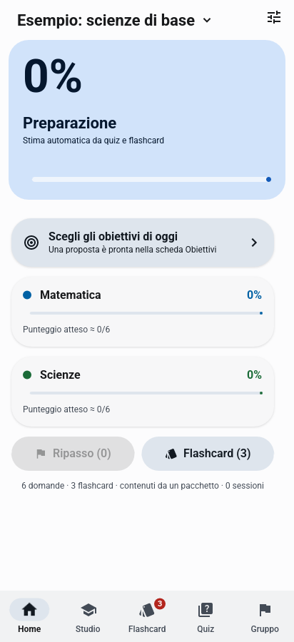
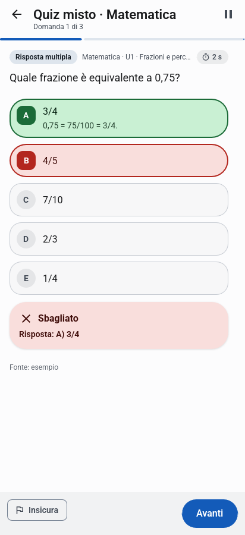
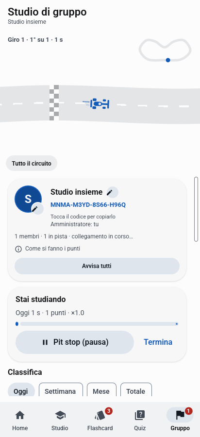
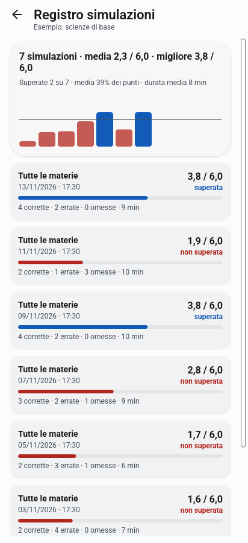

# Tremendous Preparator

App di studio per prepararsi a un esame scritto: quiz, simulazioni d'esame, flashcard con ripasso
dilazionato e lettore dei libri. Scritta in Rust con interfaccia [Slint](https://slint.dev) in stile
Material 3; gira su **Android** 8.0+ (ARM a 64 e 32 bit), **Linux** (Flatpak x86_64) e nel **browser**.
L'interfaccia è in italiano.

L'app non contiene materiale di studio: domande, flashcard, libri e regole dell'esame arrivano da un
**pacchetto contenuti** che chiunque può creare (vedi [Contenuti](#contenuti)). Il repository include
solo un piccolo [esempio](examples/esempio).

<p>




</p>

## Funzioni

- **Esami**: ogni pacchetto descrive un esame (materie, argomenti, regole, date, schede informative);
  se ne possono installare più d'uno e sceglierlo dalla Home. Il pacchetto può aggiungere a una
  materia strumenti (tavola periodica) e scorciatoie a capitoli dei libri.
- **Quiz** per argomento, unità o materia; risposta multipla o completamento (anche numerico, con
  unità di misura); spiegazione e rimando al punto del libro.
- **Simulazione d'esame** con numero di domande, tempo e punteggi definiti dal pacchetto; registro delle
  simulazioni fatte con media, andamento e ognuna da rivedere.
- **Flashcard** con ripetizione dilazionata; ripasso delle domande sbagliate o incerte.
- **Progressi**: stima della preparazione per argomento e obiettivi del giorno
  ([modello](docs/MODELLO_PROGRESSI.md)); pausa e ripresa delle sessioni; promemoria.
- **Tra dispositivi**: progressi sincronizzati senza un server dell'app (vedi [Rete e privacy](#rete-e-privacy));
  un esame installato si può passare a un altro dispositivo o, con un codice usa e getta, a un'altra persona.
- **Gruppi di studio**: classifica e una gara in cui ogni minuto di studio è un giro di pista; avvisi
  «vieni a studiare»; foto profilo; calendario dei giorni di studio mese per mese.
- **Creare un pacchetto** con un'AI passo passo, con il controllo di qualità dei contenuti; strumenti per
  dividere i PDF ed estrarne il testo, anche con l'OCR sul dispositivo (scansioni e foto).
- **Concentrazione** (Android): per il tempo scelto le altre app riportano allo studio, tranne quelle
  permesse. Chiamate, numeri d'emergenza, sveglia e schermo bloccato non vengono mai toccati.
- **Aspetto**: colore del tema a scelta; su Android 12+ anche quello di sistema.

## Installazione

| Piattaforma | Dove |
| --- | --- |
| Android 8.0+ (ARM a 64 e 32 bit) | APK nelle [release](../../releases): `TremendousPreparator.apk` è universale (se non sai quale scegliere, prendi questo); `-arm64-v8a.apk` (quasi tutti i telefoni recenti) e `-armeabi-v7a.apk` (telefoni a 32 bit) sono più leggeri |
| Linux x86_64 | Flatpak nelle stesse release: `flatpak install --user TremendousPreparator-x86_64.flatpak` |
| Browser / iPhone | <https://nernerone.github.io/tremendouspreparator/> (su iPhone: Safari › Condividi › Aggiungi alla schermata Home) |

La pre-release `beta` è costruita automaticamente dall'ultimo commit, con la stessa firma delle release; quelle `vX.Y.Z` sono le versioni
stabili ([procedura](docs/RILASCI.md)).

## Contenuti

Un pacchetto è un file `.json.gz` che contiene questa struttura (formati in [docs/FORMATI.md](docs/FORMATI.md)):

```text
content/syllabus.json        esame: materie, unità, argomenti, regole, date, schede informative
content/questions/*.json     domande
content/flashcards/*.json    flashcard
content/books.json           libri e capitoli collegati agli argomenti (facoltativo)
books/**/*.md                testo dei libri in Markdown, formule SVG
```

Si importa da *Opzioni › Pacchetto contenuti* (su Android anche aprendo il file con l'app); i progressi
non vengono toccati. Per crearne uno:

```bash
cargo run -q -p prep-core --bin prep -- validate examples/esempio
```

```bash
cargo run -q -p prep-core --bin prep -- pack examples/esempio --out=esempio.json.gz
```

`prep` offre anche `stats` (copertura del programma) e `report` (progressi). In `tools/` ci sono script
per convertire i libri: `pdf2md.py` (PDF → Markdown, OCR con tesseract), `import_md.py` (Markdown →
capitoli) e `mathsvg.mjs` (formule → SVG).

## Rete e privacy

L'app non ha un server, non ha pubblicità né statistiche d'uso e funziona offline. La rete serve alle
funzioni tra dispositivi, che partono solo quando si collegano i propri dispositivi (*Opzioni ›
Dispositivi*, con nome utente e password), si condivide un esame o si entra in un gruppo, e a due
download:

| Servizio | A cosa serve | Cosa vede |
| --- | --- | --- |
| Relay Nostr pubblici (`relay.damus.io`, `nos.lol`, `relay.primal.net`; modificabili) | far trovare i dispositivi; ripiego se il collegamento diretto non riesce | un tag casuale e dati cifrati |
| Server STUN (`stun.l.google.com`, `stun.cloudflare.com`) | scoprire l'indirizzo pubblico per il collegamento diretto | l'indirizzo IP |
| Altri dispositivi (WebRTC, Bluetooth) | scambio diretto di progressi, esami e foto | i dati, cifrati |
| GitHub (release `ocr-modelli`), Amazon S3 (`ocrs-models`) come ripiego | i modelli dell'OCR, la prima volta che lo si usa | l'indirizzo IP |
| GitHub (API e release) | solo APK e Flatpak scaricati dalle release: c'è una versione nuova? (all'avvio) | l'indirizzo IP |

Il Flatpak delle release ha il permesso `--talk-name=org.freedesktop.Flatpak`, che gli permette di
lanciare `flatpak` fuori dalla sandbox: serve solo a installare l'aggiornamento scaricato, quando si
tocca «Aggiorna». Chi non lo vuole può toglierlo con `flatpak override --user
--no-talk-name=org.freedesktop.Flatpak io.github.nernerone.TremendousPreparator` (l'aggiornamento
si aprirà allora nel gestore di software).

Se l'app si chiude per un errore, il rapporto (versione, sistema, punto dell'errore) resta sul dispositivo
in `crash/`; al riavvio l'app propone di segnalarlo aprendo nel browser una issue già compilata, che si
legge prima di inviarla. Senza conferma non parte nulla.

I messaggi sono cifrati (XChaCha20-Poly1305) con una chiave ricavata con PBKDF2 da nome utente e
password, o dal codice del gruppo: chi li conosce entra, quindi conviene una password lunga. I relay
inoltrano i messaggi senza conservarli, tranne gli avvisi dei gruppi e l'ultima scheda di ciascun
dispositivo (tempi, punti, stato: un solo evento sostituibile per dispositivo), cifrati e con scadenza
24 ore. Chi è collegato ripete anche le schede dei membri che ora non ci sono, così la classifica è
completa anche per chi non li ha mai incontrati; le foto si chiedono a chiunque le abbia.
Protocollo in [`p2p.rs`](crates/prep-core/src/p2p.rs) e [`group.rs`](crates/prep-core/src/group.rs),
collegamenti in [`net.rs`](crates/prep-app/src/net.rs) e [`direct.rs`](crates/prep-app/src/direct.rs).

### Permessi Android

| Permesso | Perché |
| --- | --- |
| Internet | sincronizzazione e gruppi |
| Notifiche, avvio al boot | promemoria e avvisi del gruppo |
| Bluetooth (e posizione fino ad Android 11, richiesta dal sistema per la ricerca) | sincronizzazione tra telefoni vicini senza Internet |
| Accesso all'utilizzo, sovrapposizione ad altre app, servizio in primo piano | modalità concentrazione: sapere quale app è aperta (il dato resta sul telefono) e mostrare l'avviso |

Il permesso per le notifiche viene chiesto al primo avvio (Android 13+), gli altri solo quando si usa la
funzione relativa.

## Sviluppo

```text
crates/prep-core   logica senza interfaccia: modello dati, quiz, correzione, ripasso, progressi,
                   archivio locale, pacchetti, protocollo tra dispositivi, gruppi
crates/prep-app    interfaccia e controller: desktop, Android, web
  src/app.rs       stato dell'app e collegamento con l'interfaccia; src/app/<area>.rs per area
  ui/              pagine Slint (ui/pages/<area>.slint), componenti, tema, stato condiviso
android/           codice Java (promemoria, Bluetooth, concentrazione, file) e risorse dell'APK
flatpak/           pacchetto desktop
web/               pagina e manifest della versione web
```

```bash
cargo test -p prep-core
```

```bash
cargo run -p tremendouspreparator --bin prepapp-desktop
```

La modalità dimostrativa (`PREP_DEMO`, `PREP_SHOTS`: vedi [`demo.rs`](crates/prep-app/src/demo.rs))
esegue una sequenza di azioni e salva screenshot.

**APK**: `tools/build_apk.sh [uscita.apk]` (servono cargo-apk 0.10, JDK 17, Android SDK con
`platforms;android-35`, NDK; dettagli nello script). Con `KEYSTORE` e `KEYSTORE_PASSWORD` l'APK esce
firmato, altrimenti non firmato. Versione e versionCode vengono da `Cargo.toml`.

**Web**:

```bash
cargo build --release -p tremendouspreparator --lib --target wasm32-unknown-unknown
```

```bash
wasm-bindgen --target web --no-typescript --out-dir site target/wasm32-unknown-unknown/release/prepapp.wasm && cp web/* site/
```

## Licenza ed esclusione di responsabilità

[GPL-3.0-or-later](LICENSE). I font inclusi (Roboto, DejaVu) hanno le proprie licenze, in
[crates/prep-app/fonts/LICENSES.txt](crates/prep-app/fonts/LICENSES.txt). L'OCR usa il motore
[ocrs](https://github.com/robertknight/ocrs) (MIT/Apache-2.0) con i suoi modelli, di Robert Knight
(licenza [CC BY-SA 4.0](https://creativecommons.org/licenses/by-sa/4.0/)): non sono inclusi nell'app,
che li scarica la prima volta dalla release `ocr-modelli` (copia identica dell'originale) o dalla fonte.

Il software è fornito «così com'è», senza garanzie (sezioni 15–16 della licenza). I contenuti che
ciascuno importa, e il diritto di usarli o condividerli, sono responsabilità di chi li importa. Relay e
server STUN sono servizi di terzi. Al primo avvio l'app mostra queste condizioni; restano in
*Opzioni › Note legali*.
